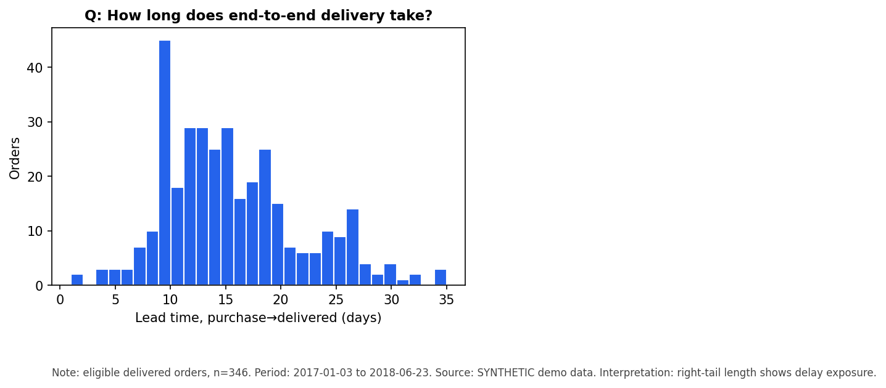
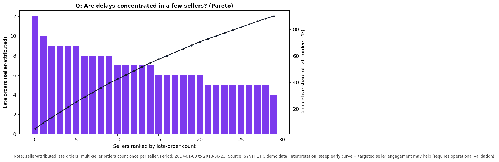

# Supply Chain Delivery Risk & Operational Improvement Lab

**Headline:** a reproducible analytics lab that turns messy e-commerce order data
into prioritized delivery-risk decisions — built for a Supply Chain Analyst role.

Late deliveries are where operations meets customer trust. This project takes the
public Olist Brazilian e-commerce dataset (~100k orders), applies strict
data-quality control, diagnoses where delays concentrate, builds an
approval-time early-warning model without outcome leakage, and simulates how a
small daily review team should spend its capacity — all reproducible from one
command, with Excel-first deliverables a consulting team can actually use.

> **Data status (honest):** real Olist CSVs are not bundled (license/download
> required — see `data/README.md`). The pipeline runs today in **demo mode** on
> deterministic synthetic fixtures; every demo number is labeled synthetic and
> empirical findings are marked PENDING until `--mode real` is run.

## Why it matters

Marketplace operations teams drown in order tables but lack answers to five
questions: **where** delays occur, **what** predicts them, **whether** risk is
visible early enough to act, **how** to ration scarce review capacity, and
**what** can responsibly be concluded. This lab answers all five with auditable
methods and no inflated claims.

## Method & workflow

```
data/raw (Olist CSVs, gitignored) ─┐
data/fixtures (synthetic, demo) ───┤─► ingestion → validation → order-level build
                                   │        │            │              │
                              SQL checks  audit trail   KPIs      diagnostics/charts
                                                              approval-time model → capacity simulation
                                                                        │                  │
                                                              Excel workbook (9 sheets) + 5-slide deck
```

- **Quality first:** identifiers, duplicates, timestamp ordering, join
  cardinality (items aggregated — orders never duplicated), transparent
  eligibility audit. Missing deliveries are never called on-time.
- **Leakage-safe modelling:** prediction at approval; chronological split;
  preprocessing fit on train; threshold from validation; test held out.
- **Honest simulation:** random vs rule vs model ranking; editable
  effectiveness/cost assumptions; Monte Carlo uncertainty; hypothetical labels.

## Findings (demo fixture — illustrative, n=600 orders / 346 eligible / 68 test)

- Late rate ~54%; mean lead time ~14d (≈5d approval→carrier + ≈10d carrier→delivery).
- MG/SP and short-promised-window segments run hotter; delays concentrate across
  sellers (Pareto) — potential contributing factors, not proven causes.
- Approval-time model: logistic ROC-AUC **0.63**, HGB 0.59, business rule 0.59.
  At 20 reviews/day, model ranking catches ~35% of test lates vs ~30% random.
- Base-case simulation (50 reviews/day, 25% assumed fix rate): ~7.6 hypothetical
  rescues/day (P5–P95 4–12). **Not observed savings.**




## Limitations

No inventory/capacity/route data (no stock or routing optimization claimed); no
observed intervention outcomes (no causal savings); undelivered orders excluded
from late rates; demo sample small. Full cautions: `reports/limitations.md`.

## Setup & run

```bash
pip install -e ".[dev]"                              # install
pytest -q                                            # 21 tests
python -m supply_chain_lab.pipeline --mode demo      # demo end-to-end
python -m supply_chain_lab.pipeline --mode real      # real data (needs data/raw CSVs)
python -m ruff check src tests && python -m ruff format --check src tests
```

Outputs: `outputs/delivery_risk_report_demo.xlsx`, `outputs/charts/`,
`outputs/*.json|*.csv`, `reports/consulting_deck_demo.pptx`.

## Repository map

| Path | Contents |
|---|---|
| `src/supply_chain_lab/` | config, ingestion, validation, features, diagnostics, modelling, simulation, excel_reporting, pipeline, make_fixtures |
| `sql/` | data_quality, operational_kpis, seller_diagnostics (DuckDB) |
| `tests/` | 21 tests incl. end-to-end demo + Excel sheet checks |
| `reports/` | executive_summary, methodology, limitations, demo deck |
| `docs/` | BUSINESS_CASE, DATA_DICTIONARY, INTERVIEW_GUIDE, BUILD_LOG, img/ |
| `data/` | README + fixtures (raw/processed gitignored) |

## Mapping to Supply Chain Analyst responsibilities

- **Investigate operational datasets** → quality-controlled pipeline + audit trail.
- **Messy data → actionable insight** → order-level KPIs, Pareto, segment tables.
- **Quantitative modelling for decisions** → early-warning model + capacity simulation.
- **Flag problems early** → approval-time risk scores, recall@capacity.
- **Excel + Python** → 9-sheet consulting workbook verified against Python; modular typed codebase.
- **Structured communication** → executive summary, 5-slide deck, interview guide.

## Transferable Skills from GRC to Supply Chain Analytics

- **Process mapping** → fulfillment-stage decomposition (approval→carrier→delivered).
- **Data validation & controls** → eligibility rules, denominator discipline, audit trails.
- **Risk/control assessment** → risk ranking under capacity constraints; assumption registers.
- **Root-cause investigation** → evidence-graded diagnostics ("potential contributing
  factor" vs proven cause; sample-size flags; outlier checks).
- **Practical decision-making** → pilot-first recommendations, measured rescue rates
  before savings claims.

## Source attribution

Brazilian E-Commerce Public Dataset by Olist via Kaggle
(https://www.kaggle.com/datasets/olistbr/brazilian-ecommerce). Raw data not
redistributed; see `data/README.md` and respect the dataset licence.
